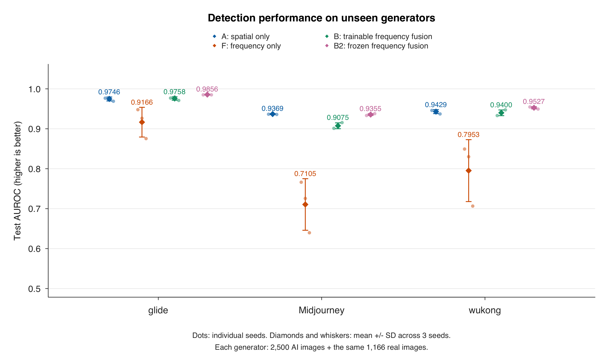
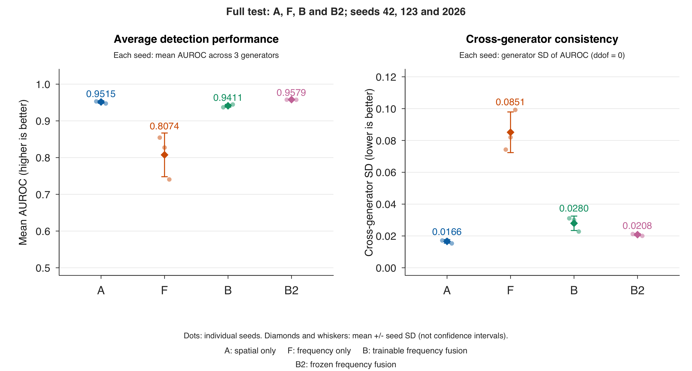

# M5 Evaluation and Analysis

The original A, F and B models were evaluated with seeds 42, 123 and 2026. All nine checkpoints use training learning rate 0.0009. Each predicts the complete 8,666-image test set, producing 77,994 records.

## Start here

- [B2 comparison: A, F, B and B2](results/b2/comparison_20261020_120113_1bc6c1/model_summary.csv)
- [B2 comparison figures and captions](results/b2/figures_20261020_122544/FIGURES.md)
- [B2 prediction run](results/b2/m5_test_20261020_113222_d903f4/run_report.json)

- [Original A/F/B results and conclusion](logs/M5_metrics_summary.md)
- [Original A/F/B Excel comparison](results/m5_scores_20261008_184008_9498f1/M5_results_comparison.xlsx)
- [Figure descriptions](results/m5_figures_original_20261008_232856_d8c2bd/FIGURES.md)
- [Error analysis](results/m5_error_examples_original_c776b30a/ERROR_ANALYSIS.md)
- [Case gallery](results/m5_error_examples_original_c776b30a/04_error_examples.png)

## Models and test protocol

| Model | Features | Classification head |
|---|---|---|
| A | Frozen spatial ResNet-18 | Linear(512, 1) |
| F | M3 pretrained frequency encoder | Linear(256, 1) |
| B | Spatial and frequency features concatenated | Linear(768, 1) |

F and B use the same frequency-encoder implementation with separately trained weights.

The test set contains 1,166 Nature real images and 2,500 images each from glide, Midjourney and wukong. Real=0 and AI=1. The original run used CPU, batch size 32, no shuffling and threshold 0.5. AUROC uses continuous P(AI).

## Frozen-frequency B2 experiment

B2 keeps both feature encoders frozen and trains only Linear(768, 1). The frequency ResNet-18 uses ImageNet-pretrained weights; its 512-to-256 projection was randomly initialized and frozen. The three checkpoints use learning rate 0.0009 and seeds 42, 123 and 2026, selected by validation AUROC.

All three B2 checkpoints were evaluated on the same complete test set. The table reports three-seed means; cross-generator SD is calculated within each seed before averaging.

| Model | Mean AUROC | Cross-generator SD | Worst AUROC |
|---|---:|---:|---:|
| A | 0.9515 | 0.0166 | 0.9369 |
| F | 0.8074 | 0.0851 | 0.7105 |
| B | 0.9411 | 0.0280 | 0.9075 |
| B2 | 0.9579 | 0.0208 | 0.9355 |

B2 improved mean AUROC over A, but its cross-generator SD was higher and its worst-generator AUROC was slightly lower. It therefore improved average detection performance without improving cross-generator consistency over A under this setting. The original A/F/B experiment is retained.





## Contents

| Folder | Contents |
|---|---|
| m5/ | Evaluation, scoring, plotting and error-analysis code |
| results/ | Full predictions, metric tables, workbook, figures and analysis |
| logs/ | Final conclusion and input manifests |
| code/ | Original test CSV |
| data/ | Six original images used in the error analysis |

The data folder contains only the six case images. The prediction CSVs and test manifest cover all 8,666 images.

## Recalculate metrics

From this folder, with Python 3.10 or later and scikit-learn installed:

```sh
python -B m5/test_scoring.py
python -B m5/score_predictions.py --run-dir results/m5_test_20261008_124810_081d31
```

The scoring command creates a new results folder. [SCORING.md](m5/SCORING.md) gives the metric definitions and Excel export command. Workbook export requires XlsxWriter. Plot generation uses base R at the Rscript path in the script. Gallery generation requires Pillow and the specified Arial font paths.

To recalculate the four-model comparison from saved predictions and verification records:

```sh
python -B m5/score_b2_comparison.py --run-dir results/b2/m5_test_20261020_113222_d903f4
```

This scoring step requires scikit-learn and uses the submitted prediction CSVs; model weights and the full image dataset are not needed.

To recreate the B2 comparison figures with base R, choose a new output folder:

```sh
Rscript --vanilla m5/plot_b2_comparison.R results/b2/comparison_20261020_120113_1bc6c1 results/b2/figures_recreated
```

## Repeat image inference

Use the original project workspace with the frozen M4 source code, nine checkpoints and complete image dataset. [model_index.json](logs/model_index.json) records checkpoint paths and hashes at training commit 58f1717aeb50da25c8db7bbebe5bbd7c38a9e266.

```sh
python -B m5/evaluate.py --mode check
python -B m5/evaluate.py --mode predict
```

Inference requires PyTorch and torchvision. The original-workspace verification script also uses the saved diagnostic run. Historical run records retain execution-time paths and source hashes.

For B2 inference, use that full workspace with the [B2 model source](https://github.com/Yummyx1010/Gen_Image_data_processing/tree/3a2735cae09d5fd8891cbfec3332b52a7369cac7/models) and the checkpoints listed in [b2_model_index.json](logs/b2_model_index.json). B2 outputs are saved separately from the original experiment.

```sh
python -B m5/evaluate_b2.py --mode check
python -B m5/evaluate_b2.py --mode predict
```
